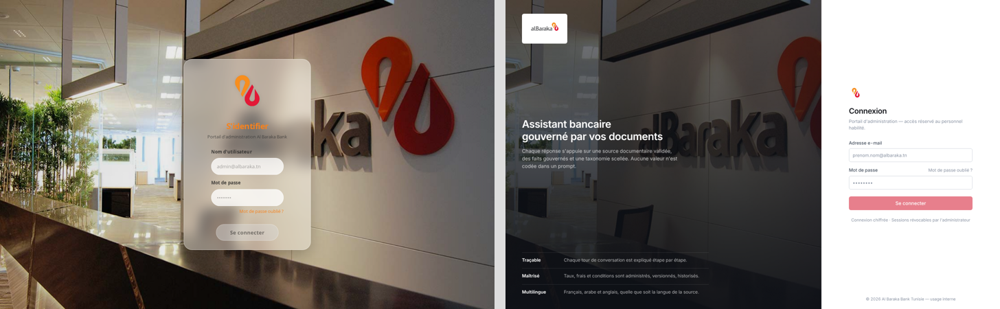
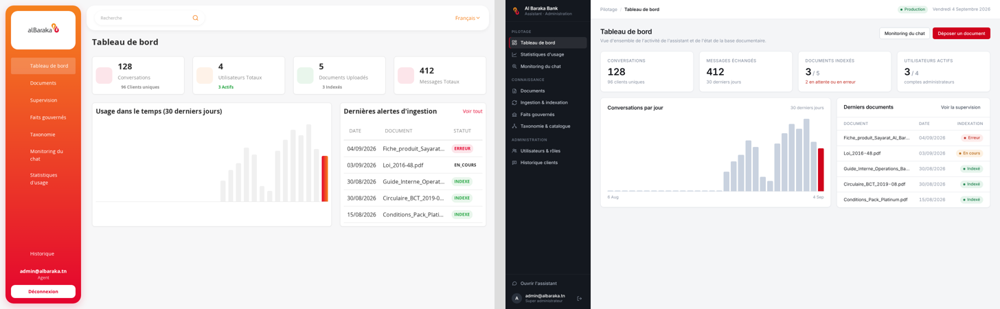
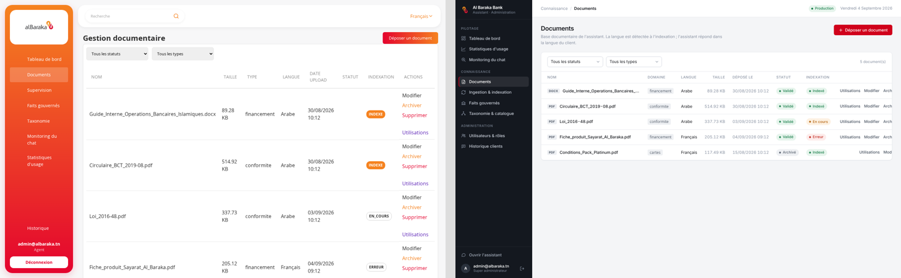
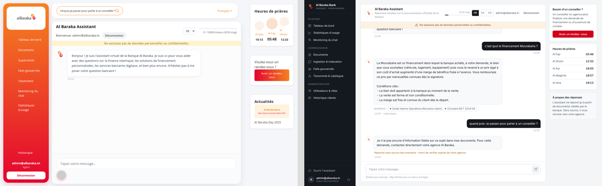

# UI screenshots

Before/after captures of the redesign (`feat(ui)`), rendered against the mock API.

Reproduce locally (no Java needed):

```bash
cd frontend
node tools/mock-api.mjs &                     # fake backend on :8081
npx ng serve --proxy-config proxy.conf.json & # SPA on :4200
npm i -D puppeteer                            # one-off, not a project dependency
node tools/screenshots.mjs out/               # 15 PNGs: every route, desktop + mobile chat
```

Left = before, right = after.

| Page | |
|---|---|
| Login |  |
| Dashboard |  |
| Documents |  |
| Chat |  |
