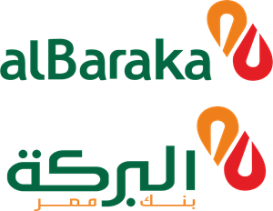
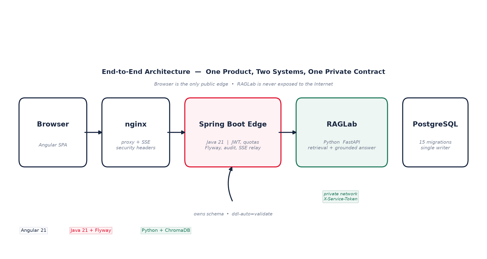
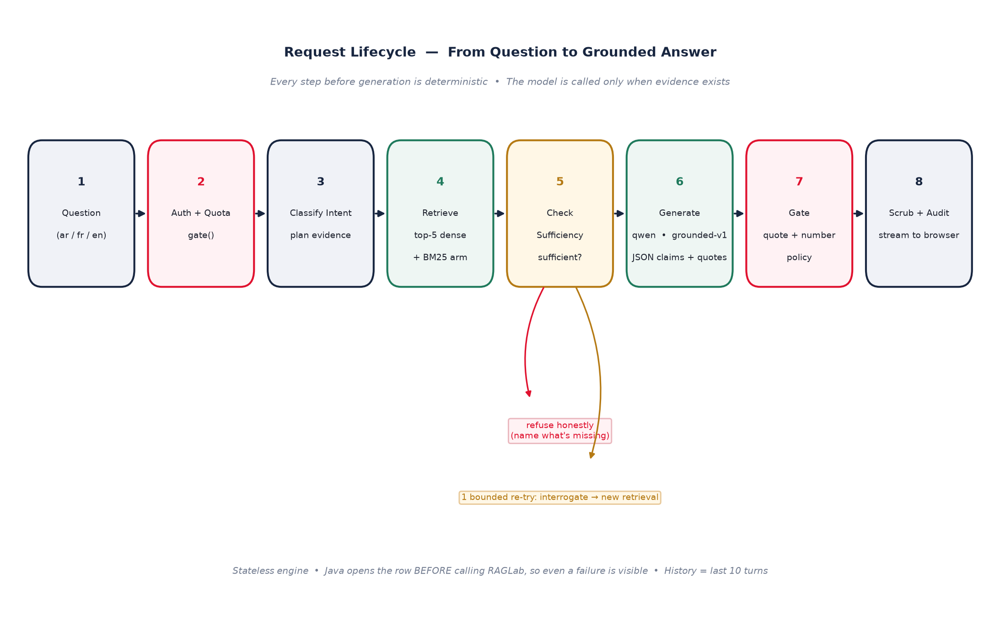
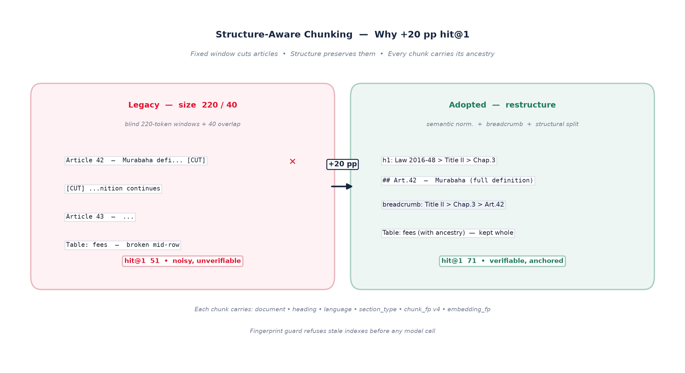

# Internship Report
## A Governed Intelligence for Islamic Banking: The Integrated RAGLab & Bank Assistant Platform

> **Farah AYARI** — ESPRIT | **Supervisor:** Mrs. Ahlem Ben Haddoud, Al Baraka Bank — Centre Urbain Nord, Tunis | **2025–2026**

 

> *All diagrams in this report are self-generated (matplotlib) — no external screenshots are used; only the two official logos above are kept.*

*The full PDF with the beautiful cover, diagrams and tables is [`Farah_Ayari_Internship_Report.pdf`](./Farah_Ayari_Internship_Report.pdf) — this Markdown is the source for the same content.*

---

### Cover Information

| Field | Value |
|---|---|
| **Student** | **Farah AYARI** |
| **Institution** | École Supérieure Privée d'Ingénierie et de Technologie — **ESPRIT** |
| **Host Organization** | **Al Baraka Bank Tunisia** — Centre Urbain Nord, Avenue Cheikh Mohamed Fadhel Ben Achour, 1082 Tunis |
| **Supervisor** | **Mrs. Ahlem Ben Haddoud** — Advisor, Al Baraka Bank |
| **Academic Year** | 2025 – 2026 |
| **Subject** | Design and Integration of a Governed Retrieval-Augmented Generation System for Banking Knowledge |

---

## Dedication

> *To my family, whose unwavering support made this journey possible,*
> *To Mrs. Ahlem Ben Haddoud, whose guidance, rigor, and trust shaped every decision in this work,*
> *And to everyone who believes that technology, when governed, can serve trust.*

## Acknowledgments

I express my deepest gratitude to **Mrs. Ahlem Ben Haddoud**, my internship supervisor at **Al Baraka Bank Tunisia — Centre Urbain Nord**, for her availability, her precise feedback, and the clarity of her decisions. At every critical junction — from the choice of the corpus to the final engine switch — her judgment turned a technical possibility into a responsible banking feature.

I thank the teams of Al Baraka Bank for their welcome, the documents they entrusted to this project, and the operational feedback that revealed defects invisible in tests.

I thank the faculty of **ESPRIT** for the training that made this project possible, and in particular for the emphasis on measurable engineering over mere demonstration.

*This report presents the work as it stands. No account identifiers, repository URLs, or credentials appear in it by design.*

---

## Abstract

In regulated banking, a wrong answer about a rate, a fee, or a deadline is not a minor inaccuracy — it is a legal risk. This internship delivered a complete, governed, and measurable answer to that reality: **an integrated platform where a bank-operated web application consumes a dedicated RAG (Retrieval-Augmented Generation) intelligence engine**, both designed to never invent figures or rules.

The platform comprises two cooperating systems:

*   **RAGLab** — a document-grounded question-answering engine over four real Arabic banking documents (Law 2016-48, BCT Circular 2019-08, an internal Islamic-operations guide, and a training primer). Every claim it produces is backed by a **verbatim quote** whose numbers must literally appear in the source; when evidence is insufficient, it refuses honestly and explains what is missing.
*   **Bank Assistant** — a trilingual (French / Arabic / English) customer and staff web application (Angular 21 + Spring Boot 4 + PostgreSQL) that owns the relational schema, authentication, quotas, persistence, and audit, and calls RAGLab over an authenticated, streaming-aware internal contract.

Together they form a **clean separation of concerns**: the edge handles identity, governance, and regulation; the intelligence engine handles retrieval, grounding, and generation — stateless, auditable, and versioned.

**Keywords:** Retrieval-Augmented Generation · Islamic Banking · Grounded Answers · Citation Verification · Arabic NLP · Spring Boot · Angular · System Architecture · AI Governance

---

## Table of Contents

1. [Host Organization: Al Baraka Bank Tunisia](#1-host-organization-al-baraka-bank-tunisia)
2. [Project Vision: A Governed Banking Intelligence](#2-project-vision-a-governed-banking-intelligence)
3. [System Architecture: The Full Picture](#3-system-architecture-the-full-picture)
4. [The Intelligence Engine — RAGLab: How It Thinks](#4-the-intelligence-engine---raglab-how-it-thinks)
5. [The Digital Bank — The Web Application: How It Serves](#5-the-digital-bank---the-web-application-how-it-serves)
6. [Problems Solved: The Hard Parts and How They Were Fixed](#6-problems-solved-the-hard-parts-and-how-they-were-fixed)
7. [Security, Privacy & Data Governance](#7-security-privacy--data-governance)
8. [Deployment & Operations](#8-deployment--operations)
9. [Results, Evaluation & Limitations](#9-results-evaluation--limitations)
10. [Conclusion & Perspectives](#10-conclusion--perspectives)
11. [References](#references)
12. [Appendices](#appendices)

---

## 1. Host Organization: Al Baraka Bank Tunisia

### 1.1 History and Identity

**Al Baraka Bank Tunisia** is the first Islamic bank in Tunisia and the Maghreb. Created on **15 June 1983** as *Beit Ettamouil Tounsi Saoudi — BEST Bank* by the Tunisian State and Sheikh Saleh Abdallah Kamel (founder of the Dallah Al Baraka Group), it changed its name to **Al Baraka Bank Tunisia** in 2009 as part of the unification of the Al Baraka Group identity. In **2013**, it obtained approval to transform from a non-resident bank into a **universal resident bank**, allowing it to serve individuals, professionals, and enterprises with Sharia-compliant products.

The Group itself, **Al Baraka Group B.S.C.**, headquartered in Bahrain Bay, operates over 600 branches in 12 countries (Jordan, Egypt, Tunisia, Sudan, Bahrain, Turkey, South Africa, Algeria, Lebanon, etc.) and serves as one of the pioneers of participative finance worldwide.

Today the bank operates **44 branches** across Tunisia, with its modern headquarters at the **Centre Urbain Nord** in Tunis — one of the capital's largest economic hubs. It has been elected **Best Islamic Bank in Tunisia (2018, 2019, 2021)** and honored with **five awards at the IFN Awards 2024**.

### 1.2 Activities

The bank's Sharia-compliant offerings include:

* **Trading & Investment:** *Murabaha* (cost-plus sale), *Salam* (deferred delivery), *Istisna'a* (manufacturing), *Mudaraba* / *Musharaka* (partnership), *Sukuk*, participative investment deposits.
* **Leasing & Financing:** *Ijara* with acquisition option, *Beit Al Baraka* (home ownership), *Tas'heelat* (personal finance), equipment and working-capital financing.
* **International & Everyday Operations:** documentary credits, remittances, leasing, and day-to-day banking.

All these operations fall under **Tunisian Law No. 2016-48 of 11 July 2016** on banks and financial institutions, which explicitly defines Islamic banking operations (Article 12–16) and entrusts the **Central Bank of Tunisia (BCT)** with regulating their compliance via circulars such as **Circular BCT No. 2019-08** — two documents that form the very corpus this project is built upon.

### 1.3 The Internship Site

> **Al Baraka Bank — Centre Urbain Nord Branch**
> Avenue Cheikh Mohamed Fadhel Ben Achour, Centre Urbain Nord, 1082 Tunis
> Tel: (+216) 71 183 203 — Head office: +216 71 18 65 00

The Centre Urbain Nord is not merely an address; it is the bank's operational heart, where product, compliance, and IT decisions converge — and where this project was supervised by **Mrs. Ahlem Ben Haddoud**.

---

## 2. Project Vision: A Governed Banking Intelligence

### 2.1 The Business Problem

Banks produce and consume vast amounts of regulatory and procedural text: laws, central-bank circulars, internal guides, training materials. Finding a reliable answer in these documents is expensive, and entrusting it to a raw language model is dangerous: a generative model always answers, even when it does not know, and nothing distinguishes a copied sentence from an invented one.

Three concrete tensions motivated the project:

1. **The user's question is rarely the document's question.** A customer asks in everyday language (*"can I open a shop?"*) where the corpus uses technical terms (*sigha, mahal al-aqd, tamwil*). The answer must be found despite this lexical gap.
2. **Multilingual asymmetry.** The corpus is in Arabic, but questions arrive in French and English. A French question must be answerable from an Arabic passage without ever translating the user or the document.
3. **Errors are costly.** In banking, a false rate, deadline, or sanction is a legal exposure — not a minor imprecision.

### 2.2 The North Star

The product was defined with five properties, in strict priority order:

1. **Grounded & Auditable** — every answer traceable to a source; nothing fabricated about rates or terms.
2. **Compliant** — PII scrubbed on the way out; no learning from customer chats.
3. **Quota-Controlled & Secure** — public channel metered; the intelligence engine unreachable from the Internet.
4. **Regulable by Staff** — administrators edit the taxonomy, governed facts, and documents.
5. **Multilingual with Arabic RTL as a first-class citizen.**

### 2.3 What Was Delivered

A **single coherent product** made of two systems that talk through a stable contract:

* **RAGLab** answers; **Bank Assistant** serves customers and governs what RAGLab knows. Neither writes into the other's store. The bank's staff sees every conversation from its first message (Java persists before calling the engine), and a customer never sees which document an answer came from.

---

## 3. System Architecture: The Full Picture

### 3.1 The End-to-End Flow


*Figure 1 — End-to-end architecture (self-generated diagram). Browser is the only public edge; RAGLab is never exposed to the Internet and is addressed by `ip:port` on a private network.*

```
Browser  ──▶  nginx (Angular SPA, /api proxy)
                 │  security headers, Server-Sent Events
                 ▼
            Spring Boot Edge (Java 21) ──▶ RAGLab (external http://<ip>:<port>)
              auth (JWT, roles)             retrieval → grounded answer → gates
              quotas, persistence,          returns text + citations + usage
              admin, monitoring             NEVER writes business tables
                    │
                    ▼
              PostgreSQL (Flyway, ddl-auto=validate)
              15 migrations · schema single-owner

RAGLab itself:
  Load & Normalize → Structure-Aware Chunking → Embed (NVIDIA 2048-d) → Index (Chroma + BM25)
                                      ↓
  Classify Intent → Plan Evidence → Retrieve (dense top-5) → Check Sufficiency → Generate (Qwen) → Gate (quote + number) → Scrub PII → Audit
```


*Figure 2 — Request lifecycle: from question to grounded answer. Every step before generation is deterministic; the model is called only when evidence exists.*


**Key separation:** the *business schema* (users, sessions, messages, documents, quotas) belongs to **Java + Flyway**. The *vector index* belongs to the **Python agent**. No shared-DB write coupling.

### 3.2 Technology Choices at a Glance

| Layer | Choice | Why This, Not That |
|---|---|---|
| **Frontend** | Angular 21 (standalone), Vitest, self-hosted Inter font | SPA with lazy modules; no Google-fonts build dependency; CSS budget enforced |
| **Backend Edge** | Java 21, Spring Boot 4, Flyway 15, JWT (JJWT 0.12), virtual threads | Edge must own schema with `validate`; virtual threads prevent carrier pinning during long SSE calls |
| **Intelligence** | Python 3.11, FastAPI + uvicorn, explicit orchestration | No LangChain/LlamaIndex — every behavior readable and auditable; stdlib HTTP, no vendor SDK |
| **Vector Store** | ChromaDB local, persistent, cosine; BM25 (k1=1.5, b=0.75) for lexical arm | Local avoids cloud cost and banking-data egress; fingerprint guards against stale serving |
| **Embeddings / LLM** | NVIDIA `nemotron-3-embed-1b` (2048-d) + xKiro `qwen/qwen3.8-max:free` | Measured best on Arabic corpus; two pinned models, zero fallback (explicit error, never silent degradation) |
| **Tokenization** | `tiktoken` `cl100k_base` + fallback estimator | Exact budget; chunk fingerprint encodes tokenizer so incompatible indexes are refused |
| **Persistence** | PostgreSQL 16+ (pgvector when needed), Redis for ingestion queue, Flyway | Single schema owner; Redis BRPOP queue is durable and ordered |
| **Deployment** | Docker Compose (5 services), `Dockerfile.prod` + offline tarball export, Windows-native path | Same images dev → prod; Windows setup scripts for non-Docker hosts; platform secrets injected, never baked in |

This sobriety is intentional: **no orchestration framework, no external vector DB, no vendor SDK in the repository** — the entire behavior is legible for audit.

### 3.3 The Two Lifecycles

* **Document lifecycle:** pushed to RAGLab via `POST /documents` (content-hash versioned; identical bytes = no-op; SHA-256 dedup guard), then batch-indexed with `POST /ingest` (one job at a time; `409` is a state, not an error). The edge's own `documents` table holds a parallel record but no longer drives indexing — RAGLab owns its index and reports it honestly (`pending / indexed / stale`).
* **Conversation lifecycle:** browser → edge (quota gate) → RAGLab (retrieval → generation → gate) → edge (scrub → persist → settle quota → stream). The edge opens the exchange row **before** calling the engine so even a failure is visible to staff.

---

## 4. The Intelligence Engine — RAGLab: How It Thinks

### 4.1 Corpus and Linguistic Challenge

The evaluation corpus is **four real, unabridged Arabic documents**:

| Document | Role | Fragments (restructure) |
|---|---|---|
| **Law 2016-48** (Tunisian Banking Law, 198 articles, 11 titles) | Superior legal reference | 233 |
| **BCT Circular 2019-08** (20 chapters) | Operational framing | 13 |
| **Internal Islamic Operations Guide** | Internal policy & compliance | 54 |
| **Introduction to Islamic Finance (Madkhal)** | Training, definitions, magnitudes | 39 |
| **Total** | | **339** |

The PDFs are scanned legal Arabic: visual-order lines, reversed word order, corrupted digits, broken headings. This makes them **unusable without repair** — a problem solved linguistically, not algorithmically (see §6).

### 4.2 Three-Step Structure-Aware Chunking

The project implements two chunkers and measures both. The legacy `size` mode (220 tokens + 40 overlap) remains; the adopted `restructure` mode dominates:

1. **Semantic normalization** — gazette header cleanup, repeated-header dropping (≥3 occurrences), section-marker extraction (`al-fasl / al-bab / al-qism`), visual-order Arabic repair (zone reconstruction + RTL fix), preserving document hierarchy into Markdown (`#`, `##`, `###`).
2. **Breadcrumb enrichment** — injecting `h1 > h2 > h3` context above every heading and table, so a chunk carries its ancestry even when retrieved alone.
3. **Recursive structural splitting** over `["\n# ", "\n## ", "\n### ", "\n\n", "\n", " "]` at the same 220/40 budget.

Each chunk carries an **identity card**: `document`, `chunk_index`, `heading`, `language`, `section_type`, `chunk_fp` (fingerprint v4 encoding mode/size/overlap/tokenizer), `embedding_fp`, and `embedding_model`.

*Result:* structural chunking gains **+20 points of hit@1** over window splitting (live: 51 → 71; offline BM25: 42 → 62) — the single largest architectural win.

### 4.3 Embeddings and Storage

* **Model:** `nvidia/nemotron-3-embed-1b`, native **2048 dimensions**, via NVIDIA Build endpoint (batch 32, retry with exponential backoff + Retry-After, bisect on degenerate vectors, resumable cache).
* **Store:** one **ChromaDB persistent collection per (embedding-space × chunking mode)**, `hnsw:space=cosine`. BM25 lexical index is maintained in parallel for hybrid modes.
* **Fingerprint guard:** `chunk_fp + embedding_fp` are stored per chunk; retrieval over a stale collection is refused **before any model call** with remediation instructions (`ingest --reset`). No mixed indexes are ever served.

### 4.4 Retrieval: Dense Wins

Three retrieval modes are implemented and measured:

* **vector (dense)** — cosine similarity, top-20 candidates → top-5 answer window.
* **RRF** — Reciprocal Rank Fusion (k=60) of dense + BM25.
* **blend** — score fusion `λ·cosine + (1−λ)·BM25norm`, λ=0.7.

**Measurement (frozen 50-question set, live models):**

| Mode | hit@1 | hit@3 | hit@5 |
|---|---|---|---|
| **vector (default)** | **71** | **80** | **87** |
| RRF (BM25 fused) | 71 | 80 | 82 |
| blend λ=0.7 | 62 | 80 | 84 |

In French, the gap is sharper (dense 50/67/67 vs RRF 33/33/50). **Decision: dense stays default**; the others remain explicit options, never silently blended. A deterministic feature-based reranker (activated after measured 62/82/87 → 62/89/89 offline) provides a cheap second pass.

### 4.5 Understanding the Question

Before retrieval, a **deterministic-first** understanding layer runs:

| Module | Function |
|---|---|
| `intent.py` | Rule-based intent classification (first matching rule wins); splits compound requests; detects influential ambiguity |
| `evidence_plan.py` | Derives **evidence requirements** (what must be present to answer) — never the answer itself |
| `sufficiency.py` | Confronts plan vs retrieved fragments; emits **sufficient / insufficient / contradictory / indeterminate**; proposes bounded guided rounds |
| `decompose.py` | Breaks a question into micro-questions (built, not yet wired) |
| `interrogate.py` + `topic_map.py` | **Only when nothing is covered:** one bounded LLM call re-expresses the practical question as the nearest technical question the corpus covers, choosing topics from a 262-node map (198 law units + 20 circular chapters). Fail-closed: malformed output / invented topic / invented requirement / identical paraphrase → normal refusal |

**Guarantees of interrogation:** closed failure, full disclosure (`understood_as`, `original_question`, `interrogation` seconds exposed), visible cost, and a single call — never a loop.

### 4.6 Delivery: Citation Gate, Scrubbing, Audit

* **Prompt (`grounded-v1`):** question + sources declared **untrusted data**; model has no account, no live data, no tools; output is strict JSON `{answerable, claims:[{text, evidence:[{source_id, quote}]}]}`; quotes must be ≥12 chars, contiguous, verbatim; no citation markers inside claims.
* **Citation gate (three checks):**
  1. **Quote membership** — normalized (Arabic NFKC, casefold, whitespace) quote must be substring of cited source.
  2. **Numeric gate** — every digit-form number in a claim must appear in its quotes (decimal/thousands + Arabic-Indic digits handled); violation → `unsourced_number` refusal with raw preview.
  3. **Policy gate** — cited source must have been retrieved, belong to allowed documents, and be in force when the governance axis is set.
* **Engagement of sufficiency:** if nothing is covered, the service refuses **before** any generation, naming missing requirements; if coverage is partial, one bounded regeneration is allowed.
* **PII scrubbing:** after the gate, emails, phones, Tunisian RIB/IBAN (20-digit / TN59), contextual CIN → `[LABEL]` placeholders. The gate sees raw text; the customer sees scrubbed text.
* **Audit trail:** every request leaves a JSONL trace (trace ID, timestamp, scrubbed question, status, sufficiency state, model, counts, latency), exposed via `GET /audit` (500-entry cap), and correlated across Java + Python via `X-Request-Id` / `X-Turn-Id`.

### 4.7 Knowledge Layer (on Law 2016-48)

A curated, declarative layer that extends — without replacing — retrieval:

* **198 knowledge units** (= 198 articles), literal text, stable ID `loi-2016-48:artNNN`, hierarchical path, functional type.
* **77 internal cross-references** + 1 anchoring relation (Circular → Article 11) with literal proof obligations.
* **53 structured number records** (14 rates, 28 deadlines, 5 caps, 6 sanctions) + 15-line correction table, served via `GET /numbers` — the first additive-only endpoint under the endpoint freeze.
* **6 governance axes** (authority, validity, scope, audience, domain, source) on fragment metadata.

**Measured impact:** a unit-description index answers law questions at **100/100/100** (hit@1/3/5) vs 67/92/92 for the restructure baseline — every law question, including cross-lingual, finds its article at rank 1.

---

## 5. The Digital Bank — The Web Application: How It Serves

### 5.1 Overall Shape

The web app is **the only public edge**. RAGLab is never exposed to the Internet; it is addressed by `ip:port` on a private network with a shared `X-Service-Token`.

* **Frontend** (Angular 21, standalone, lazy modules): public landing page (`/`), chat widget, authentication, client portal, and admin back-office under `/admin/**`.
* **Backend** (Spring Boot 4, Java 21): JWT authentication, Flyway migrations, quotas, persistence, monitoring, and the five-tab **RAGLab Console** that drives the engine explicitly.
* **Database**: PostgreSQL, Flyway single-owner (`V1` … `V15`), `ddl-auto=validate`. No second writer.

### 5.2 Public Experience


*Figure 3 — Structure-aware chunking: blind windows cut articles; restructure preserves them with breadcrumb ancestry (+20 pp hit@1).*

* **Landing page at `/`:** trilingual hero, products, assistant showcase, services, FAQ, footer — brand tokens from Al Baraka palette (Red `#E0122F`, Orange `#F5881C`) with RTL support.
* **Floating assistant widget:** same SSE endpoints as authenticated chat, with its own session — reachable without login, quota-limited.
* **Authentication split:** **Client** vs **Staff** tabs on login, role-based redirect. Registration at `/register`.
* **Client portal `/portal`:** accounts, cards, transactions, financing simulations, advisor appointments, profile, and a ChatGPT-style assistant that carries the client's own conversation history.

### 5.3 Customer Accounts — The Core Banking Shape

The `V15` schema models a realistic core-banking domain (not a toy):

| Domain | Tables & Key Fields |
|---|---|
| **Identity & Risk** | `clients` (CIN, reference `ABK######`, segment, `langue_preferee`, KYC status, risk level, branch `agence_id`, employer, income) |
| **Money** | `comptes` (IBAN, RIB, `solde`, `solde_disponible`, `decouvert_autorise`, `statut`), `cartes` (masked `porteur` like `4571 **** **** 6842`, no PAN/CVV stored), `transactions` (operation/value dates, counterparty, channel, amount, status) |
| **Products** | `financements` (contract ref, form *murabaha/ijara*, purpose, amounts, margin, installments, `capital_restant`), `beneficiaires` (name, RIB, bank, country) |
| **Service** | `advisor_requests` (motive, meeting method, branch, date/time, free-text message) |
| **Conversation** | `conversations`, `public_chat_session`, `messages` (scrubbed question/answer, `sources_utilisees`, `trace_json`, session/IP) |

**Design decisions that matter:**
* No full card numbers or CVV ever stored — the `porteur` is masked at source.
* Transactions may contain third-party names (stores, operators) — these are third-party personal data and must be treated as such.
* The assistant never sees raw balances; for a signed-in customer asking about their own situation, a **masked context** (`CustomerContextService`) is derived at call time: slices and categories only, no direct identifiers leave the bank.

### 5.4 Authentication, Roles & Quotas

* **JWT with server-side refresh-token rotation:** access tokens ≤ 1 h; refresh tokens carry `jti`, belong to a `family`, are single-use (`rotated`) with **reuse detection** (presenting a consumed `jti` burns the whole family → 401, theft signal). `POST /api/auth/logout` revokes idempotently; admin role change / deactivation / delete revoke all sessions for that subject.
* **Dynamic staff roles:** `admin_roles` + `admin_permissions` + `role_permission` + `admin_access_audit` (Flyway `V14`). Twelve fixed permissions (e.g., `DOCUMENTS_PROCESS`, `RAGLAB_CONSOLE_MANAGE`) map to server-enforced actions. `SUPER_ADMIN` is system-reserved; at least one must remain active; unknown roles/permissions fail closed; every change audited with mandatory reason.
* **Two-phase metering:** `gate()` before calling the engine, `settle()` after. Anonymous: 3 000 tokens / 20 messages; authenticated: 10 000 / 50; max 5 new sessions/hour. Per-session **striped ReentrantLocks** (64 stripes, not `synchronized`) serialize `gate → call → settle` so a slow engine cannot be gamed — and because the backend runs on **JDK 21 virtual threads**, this avoids carrier pinning. Horizontal scale-out would require a DB optimistic lock on the session row (documented).

### 5.5 Streaming & Persistence

* **End-to-end streaming:** Python `GroqCompletion.stream` → Java `AgentClient.invokeStream` (pinned to **HTTP/1.1** — see §6) → Java SSE relay `POST /api/chat/message/stream` → browser `fetch + ReadableStream` parser → single assistant bubble with blinking caret + final counters. Fallback to classic `POST /message` if streaming unavailable. Abort button cancels cleanly.
* **Persistence:** Java is the single writer. It opens `ConversationEntity` + `MessageEntity` **before** calling RAGLab, persists the exchange after streaming completes, writes attribution (`engine = RAGLab`) and provenance, and never writes to RAGLab's store. History depth: last **10 turns** passed as context to the stateless engine (`turn_id` for idempotency, echoed as `X-Turn-Id`).

### 5.6 Admin Console — The Control Room

The back-office lives under `/admin/**` (StaffGuard), in French (internal staff), role-aware:

| Screen | What It Does |
|---|---|
| `/admin/facts` | **Governed facts CRUD** — rates/fees/eligibility in `business_fact` (append-only audit `business_facts_audit`, no hard delete, reason mandatory). Vocabulary mirrors the agent enums. This is where facts **beat documents**: a fact outranks any passage. |
| `/admin/taxonomy` | **Exemplar & release management** — domain/intent catalog (RTL for Arabic text), soft-deactivate, `seal()` to freeze active exemplars into a numbered release (`CatalogRelease` + `CatalogReleaseExemplar`), `publish` to rollback. Sealed copy is what the classifier embeds at boot; agent restart picks it up. |
| `/admin/agent/health` | **Connection & health** — effective `RAGLAB_URL` (deployed default, overridable by SUPER_ADMIN, persisted in `agent_endpoint` V11, audited), live `GET /health` probe with latency and raw reply. "Not configured" is an honest state. |
| `/admin/agent/quality` | **Quality workbench** — *does the answer have a quote? Did retrieval find the right passage? Does this quote exist in corpus?* (`POST /answer`, `POST /search`, free `POST /chunks/search`). Unquoted claims and unused sources flagged. |
| `/admin/agent/documents` | **One drop zone, two chunk worlds** — shared file world, in-house ingestion status/journal (historical), and RAGLab index state (what that service reports about itself, facts absent rather than zeroed). RAGLab uses its own `POST /documents` + batch `POST /ingest` with poll. |
| `/admin/agent/config` | **Models & keys** — in-house agent exposes `GET/PUT /config` behind the same token; chat model/key replaceable from UI (SUPER_ADMIN, `CONFIG_SET` audited, key write-only with fingerprint). RAGLab settings are read-only here — shown as reported, with restart guidance. |
| `/admin/agent/journal` | **Audit journal** — every admin action filterable by action (values read from the journal itself) and searchable, with motive as its own column. Spending reads visually distinct from writes. |
| `/admin/agent/monitor` | **Monitoring** — live feed filterable by engine, KPI strip comparing engines (turns, grounded, refused, grounding rate, share with sources, refusal reasons) over last 200 exchanges. Attribution via `RAGLAB_*` intent tags, no new column needed. |
| `/admin/ingestion` | **Document state & worker journal** — file state + journal feed, re-ingest button, cache-generation invalidation (`agent:cache:generation` UUID). |
| `/admin/users`, `/admin/monitoring` | Staff management & news monitoring |

### 5.7 News, Advisors & Simulations

* **News:** `NewsItem` with public `GET /api/news` + admin CRUD, for bank announcements.
* **Advisor requests:** customer creates a request (motive, branch, date/time, message); staff sees and updates status.
* **Financing simulations:** request/response DTOs for *Murabaha* / *Ijara* scenarios, grounded in published bank figures (coverage ratios, 7-year terms) — the Mourabaha margin is **deliberately not seeded** (public site contradicts legacy prompts), so an admin must enter it explicitly.

---

## 6. Problems Solved: The Hard Parts and How They Were Fixed

This section is the heart of the internship: not what was planned, but what broke — and what architecture prevents it from breaking again.

### 6.1 Arabic PDFs Are Not Text — They Are Pictures of Text in Visual Order

**Problem:** Extracted Arabic from banking law PDFs comes out in **visual order** (right-to-left lines as rendered, not logical order), with split words, repeated gazette headers/footers, and every digit corrupted. Feeding this directly to an embedder creates an index of nonsense.

**Solution:** A dedicated `restructure.py` pipeline:
* NFKC normalization + Arabic presentation-form repair, alef/yah unification, tatweel/diacritics stripping.
* Page/gazette header cleanup and repeated-header dropping (≥3 occurrences).
* Section-marker extraction (`al-fasl / al-unwan / al-bab / al-qism`) to restore hierarchy.
* **Visual-order reconstruction** by zone — lines reordered into logical reading order before chunking.
* Breadcrumb enrichment before splitting, so order errors do not propagate as isolated fragments.

The linguistic repair itself was performed **batch by batch** (29 batches for the law alone: 215 corrections, then 35 for the circular, 23 for the guide, 21 for the primer), each checked by `llm_repair_check.py` and adopted only after supervisor sign-off. Raw `docs/` files are **never modified**; the corrected codices are applied inside the pipeline, versioned in `raglab/audits/`.

### 6.2 A 220-Token Window Destroys Meaning

**Problem:** Fixed-window chunking (220 tokens + 40 overlap) routinely cuts a legal article mid-definition, making the passage unverifiable.

**Solution:** Structure-aware chunking (see §4.2). Measured gain: **+20 pp hit@1** (51 → 71 live; 42 → 62 offline). This single change outranked every retrieval-mode experiment.

### 6.3 Searching in Arabic With French/English Questions

**Problem:** Users write technical terms in Latin script (*murabaha, sukuk*) while documents use Arabic script (*مرابحة, صكوك*). A lexical search has zero overlap; a pure vector search may miss without a bridge.

**Solution (layered, not single-trick):**
* Native multilingual embeddings (NVIDIA 2048-d) handle most cross-script cases via vector similarity.
* **Declared cross-script bridges** — curated Latin→Arabic equivalences (e.g., *murabaha→مرابحة*), df-checked so a bridge onto boilerplate can never anchor evidence (zero-regression proved via `diag_bridge.py`).
* **Colloquial concept vocabulary** — e.g., *hana/khamara/bar→khamr* (alcohol), *qimar/casino→maysir* (gambling), with scope disclosure (`scope_note` + `answered_reaimed_question`) when a question is re-aimed.
* One bounded **interrogation call** that rewrites a practical question into the nearest technical question the corpus covers, re-evaluated deterministically with full disclosure.

### 6.4 The Guided Retrieval Round Was Dead in Production

**Problem:** A deployed-service bug: the sufficiency controller was called **without a search function**, so the guided rescue round (the second retrieval that follows an "insufficient" verdict) never executed in production — only in offline tests.

**Fix:** The live service now passes the search callable; the defect was invisible in tests and obvious in operation — establishing the rule that *any claim about the deployed service must be verified on the deployed service*.

### 6.5 The Index Was Silently Duplicating

**Problem:** Re-pushing an identical document created duplicate chunks (859 of 1 713 observed), inflating term frequencies and corrupting retrieval. The legacy append-only path had no guard.

**Solutions:**
* **RAGLab side:** content-hash `409` guard — `document_already_in_corpus` (SHA-256, not filename) refuses a byte-identical re-push idempotently; batch `POST /ingest` is one job at a time (concurrent ingest → `409` state, not error).
* **In-house fix (before removal):** `delete_source` now purges by collection + collection_id + `cmetadata->>'source'` (jsonb) before upsert, and a purge failure fails the job rather than silently appending.
* **Dedup of documents themselves:** `POST /documents` content-hash versioning in RAGLab: same id + identical bytes = no-op; different bytes = version bump.

### 6.6 French Intent Misclassified by a Substring Match

**Problem:** The regex `Quelle` (French procedural marker) matched **inside** the word `Quelles`, misclassifying a procedural question as definitional.

**Fix:** Anchored markers + dedicated French procedural patterns, covered by regression tests on the live question set.

### 6.7 The Streaming Client Sent HTTP/2 Upgrade That Uvicorn Rejected

**Problem:** `java.net.http.HttpClient` defaults to HTTP/2 and sends `Upgrade: h2c`; uvicorn (serving RAGLab) rejected it with `422`. The browser saw a broken stream.

**Fix:** Pin `AgentClient.invokeStream` to **HTTP/1.1** explicitly. One-line cause, days of debugging.

### 6.8 Two Sensitive Configuration Errors

* **Hardcoded token in Compose overriding env:** a baked-in `X-Service-Token` silently won over the operator's environment variable — fixed by honoring env composition priority.
* **Network errors leaking as 500:** provider failures now return explicit `502` (bad gateway) with scrubbed detail, never a generic 500 that hides the cause.

### 6.9 Nginx Cached the Wrong `index.html`

**Problem:** `index.html` was cached by nginx, so a rebuilt frontend served an unstyled page; critical-CSS inlining injected an `onload` handler that the Content Security Policy blocked.

**Fix:** No-cache for `index.html`; critical-CSS inlining disabled.

---

## 7. Security, Privacy & Data Governance

### 7.1 Defense in Depth

| Layer | Mechanism |
|---|---|
| **Network** | Only nginx is public; backend + Postgres + RAGLab on private network/VPC subnet with no Internet ingress. Edge proxy terminates TLS, enforces HSTS, forwards `X-Forwarded-For` (trusted from edge only). |
| **Authentication** | JWT (≥256-bit secret, never in repo); shared `X-Service-Token` for edge→RAGLab, constant-time `hmac.compare_digest`. Unset token = open service locally (documented, refused in production readiness). |
| **Authorization** | All admin controllers `@PreAuthorize`; staff roles via DB-backed permissions (12 fixed capabilities); client `UTILISATEUR` role isolated; unknown role → fail-closed 403. |
| **Input** | Filename validation (no path separators/control chars); document size cap `RAGLAB_MAX_DOCUMENT_BYTES` (default 20 MiB → 413); upload magic-byte consideration pending. Enum validation on `mode/lang_filter/query_lang` → 400. |
| **Prompt Injection** | System prompt declares question+sources **untrusted data**, forbids role change/tool use/background knowledge; capability regex guard (`needs_private_or_live_data`) refuses "my balance/password/live rate" locally, zero LLM call. Conservative, not a security classifier — stated as such. |
| **Output** | PII scrub after gate (never before, so gate accuracy preserved): EMAIL, PHONE, Tunisian RIB/IBAN, contextual CIN → `[LABEL]`. Amounts/dates untouched. |
| **Secrets** | Only in env / platform secrets; `GET /keys` returns presence + fingerprint; `POST /keys` rejects placeholders; cached embedder invalidated on change. |

### 7.2 Personal Data — What We Hold, What We Do Not

The platform holds nine families of customer personal data across `clients`, `comptes`, `cartes`, `transactions`, `beneficiaires`, `financements`, `advisor_requests`, `conversations`, `refresh_tokens` — from direct identifiers (email, CIN) to financial (IBAN/RIB, balances) to free-text (chat questions, appointment messages). Two truths matter:

1. **Nothing identifiable leaves the bank to the intelligence layer** beyond a masked slice/category context, built at call time and only for an authenticated customer asking about their own situation.
2. **The highest real risk is free text:** a customer's question (`messages.question`) may contain an account number, a name, or a national ID; it is stored verbatim and shown to staff. The mitigation is the output scrub and the audit trail — but the gap (no retention/deletion lifecycle, no input-side PII detection) is documented as a pre-production requirement, reviewed with the legal team.

No full card PAN or CVV is ever stored. Transaction rows may contain third-party personal data (store names) — a GDPR-relevant nuance for the production DPIA.

### 7.3 Audit & Traceability

* Every answer carries `citations` (source id, chunk id, verbatim quote) and the answer engine is attributed per turn (`RAGLAB_*`).
* Every admin action (fact change, taxonomy seal/publish, model switch, document rebuild, key change) is written to `agent_admin_audit` with **mandatory reason**.
* Every ingestion outcome writes `JournalIngestion` (`SUCCES/ERREUR` + chunk count), surfaced in the control room.
* Every conversation is visible from its first message; monitoring KPIs (grounded rate, refusal reasons) are computed over the last 200 exchanges, attributing by engine even for historical turns.

### 7.4 Threat Pass

A 20-point checklist (see `THREAT_PASS_6.2.md`) drove concrete fixes: second unauthenticated chat door removed, string compares hardened to constant-time, response hardening headers (CSP, frame-deny, nosniff) set at both nginx and Spring, Swagger disabled in `prod` profile, host ports bound to `127.0.0.1`.

Remaining gaps (documented, not hidden): upload magic-byte sniffing, per-request DB auth for access-token revocation vs hourly rotation, Redis auth in production, nightly purge of refresh tokens expired >30 days.

---

## 8. Deployment & Operations

### 8.1 One Image Set, Three Environments

| | **dev** | **staging** | **prod** |
|---|---|---|---|
| How | `docker compose up` (this repo) | same images, real TLS, prod-like volume | same images, HA stores |
| `SPRING_PROFILES_ACTIVE` | (default) | `prod` | `prod` |
| Swagger | on | off | off |
| `LOG_FORMAT` | plain / json | ecs | ecs |
| Secrets | `.env` (local) | platform secrets | platform secrets |
| Data | throwaway | anonymized copy monthly | live |

**Rule: promotion moves image digests dev → staging → prod; never rebuild for prod.** `deploy/promote.sh` enforces it: refuses a dirty tree, tags with commit SHA (never `latest`), and `verify` compares `GET /actuator/info → build.gitSha` and `GET /version.json → sha` against `HEAD`.

### 8.2 Topology

```
Internet —443(TLS at edge, HSTS)→ Edge Proxy (Traefik/nginx/LB) —80(private)→
  frontend (nginx SPA) —/api→ backend (Spring Boot) —→ RAGLab (private, never published)
                              │
                           Postgres (PITR: daily full + WAL, 30-day retention, quarterly drill)
```

Postgres is managed-service where available; Flyway runs at backend boot (`spring.flyway.enabled=true`). `docker-compose.prod.yml` (per host, not committed) sets `prod` profile, removes host port mappings for backend/Postgres, and points at secret files. Kubernetes translation is one-to-one (each compose service → Deployment + ClusterIP; frontend is the only Ingress backend; NetworkPolicy allows RAGLab ingress only from backend).

### 8.3 Deploy Procedure

```bash
TAG=v1.0.0 docker compose -f docker-compose.yml -f docker-compose.prod.yml pull
docker compose -f docker-compose.yml -f docker-compose.prod.yml up -d backend
docker compose logs backend | grep -E "Flyway|Migrating|Successfully"
docker compose -f docker-compose.yml -f docker-compose.prod.yml up -d frontend
E2E_BASE_URL=https://assistant.example.tn ./e2e/run.sh
```

Flyway migrations (`V1` … `V15`) are expand→migrate→contract; a non-idempotent `V1` was rewritten and baselined at `0` — the fix that makes the migrations CI job possible at all.

### 8.4 Observability

* **Correlation:** `turnId` minted once per turn in Java, sent as body + `X-Turn-Id`, bound to MDC (Log4j) and a Python `contextvar` — one grep spans both services; `X-Request-Id` echoed on every response.
* **Logs:** structured — backend `ECS` (Spring structured logging), Python `JSON` (`albaraka/observability.py`); uvicorn access logs preserved.
* **Metrics:** backend `GET /actuator/prometheus` (SUPER_ADMIN or `METRICS_PUBLIC=true`) → `chat_turns_total`, `chat_turn_duration`, `chat_tokens_estimated_total`; Python `GET /metrics` → `agent_turns_total`, `agent_answer_chars_total`, `agent_cache_events_total`. OpenTelemetry tracing is the next documented step.

### 8.5 Runbooks

`RUNBOOK.md` covers incidents, ingestion failures, credential rotation, and regulatory audit queries. `HOST_TESTING.md` + `docker-compose.test.yml` give a one-command full-stack test on a workstation (seeded accounts: staff at every permission level, four customers with accounts/cards/movements/financings).

---

## 9. Results, Evaluation & Limitations

### 9.1 How Quality Is Measured

Two frozen question sets anchor every claim:

* **`questions_50.json`** — 50 cases: 10 verbatim, 20 paraphrases, 15 cross-lingual (6 FR + 9 EN), 5 out-of-scope. 32 AR / 8 FR / 10 EN. Expected document + expected substring verified as literally present and distinctive per document.
* **`questions_targets.json`** — 10 Arabic cases: 2 per category (colloquial, synonyms, implicit request, compound request, ambiguity).

**Rules:** paired comparison in the same run; ±2 pp tolerance across runs (served models are not bit-reproducible); a frozen set is never edited to improve a result; offline BM25 filters cheaply, live runs decide.

### 9.2 Headline Results

| What | Result |
|---|---|
| **Chunking** (live vector, 50 cases) | `size` 51/64/71 → **restructure 71/80/87** (hit@1/3/5) — +20 pp hit@1 |
| **Retrieval modes** (restructure, live) | dense **71/80/87** > RRF 71/80/82 > blend 62/80/84 — dense default |
| **Reranker** (offline) | 62/82/87 → **62/89/89** — activated |
| **Knowledge unit index** (law, 12 cases) | reference 67/92/92 → **100/100/100** — every article at rank 1 |
| **Target categories** (10 cases, dense) | compound 100/100/100 · implicit+ambiguous 50/100/100 · synonyms 50/50/50 · colloquial 0/0/0 (documented, addressed via vocabulary) |
| **Model independence** (same retrieval, 2 answer models) | agreement **0.720**; Jaccard of cited sources **1.000** when both answer — divergence is accept/refuse, not which source |
| **Phase 9 final campaign** (7 + 12 + 6 cases, live) | retrieval 5/7 · topic map 5/5 targets · end-to-end 3 answered / 3 refused, zero provider errors, k=5/12/20 no change |
| **Robustness** | 6 adversarial scenarios (fabricated quote, borrowed quote, computed number, unknown citation id, marker in claim, injection in question/source) — all rejected deterministically |
| **Tests** | 472 unit + 133 offline checks · 472/133 green at merge · 8 CI workflows · 469 hard-harness families |

### 9.3 What the System Does Not Do (Yet)

* **Citation existence ≠ entailment.** The gate proves words and numbers come from the source, not that the claim logically follows — stated explicitly.
* **No similarity threshold.** Top-5 are transmitted even if off-topic; safety rests on sufficiency + refusal.
* **Single worker.** One profile, one index, one ingestion at a time; horizontal scale is a parked, designed item.
* **Updates by re-ingestion.** A replaced document's old fragments serve until next ingest (now surfaced honestly as `stale`).
* **Tokenizer variance.** Without `cl100k` vocab, chunk boundaries differ (estimator) — only CI is authoritative.
* **Evaluation scale.** 50 + 10 cases are small and correlated — not a security, legal-correctness, or availability guarantee.

The repository states it plainly: **suitable for a supervised pilot on approved non-confidential documents; not ready for unsupervised customer-facing banking advice.**

---

## 10. Conclusion & Perspectives

### 10.1 What Was Built

A working, documented, and measurable platform:

* A **complete language pipeline** — document reading and repair, structure-aware chunking, vector + lexical indexing, dense retrieval, intent and sufficiency reasoning, citation-gated generation, output scrubbing, and audit.
* A **four-layer governed architecture** — corpus/structure, knowledge, understanding, delivery — born from an honest mid-project pivot away from a flat retrieval lab.
* **Measured wins** — +20 pp from structural chunking, 100 % on the law unit index, 0.720 cross-model agreement with identical sources, frozen sets as non-regression guardians.
* A **service** — 25–27 routes, frozen contract, audit trail, container image, and operator guides, consumed by a bank-operated web app that owns identity, quotas, and persistence.

### 10.2 Lessons That Outlive the Code

1. **Measurement replaces opinion.** Every structural choice — restructure over window, dense over fusion, lexicon off, relational expansion abandoned — was settled by paired numbers, and several reasonable intuitions were rejected by data.
2. **Governance of decisions is architecture.** The step-and-plan protocol, activation gates, and frozen question sets are what allowed the project to survive interruptions without silent regression and to distinguish progress from displacement.
3. **Reality is the only judge.** The most expensive defects — the inert guided round, the French intent misclassification, index duplication — were invisible in tests and obvious in operation. Any claim about the deployed service must be checked on the deployed service.

### 10.3 Next Steps

1. **Identity & roles follow-through:** per-document authorization scoping and chunk-level topical metadata (`path / level / parent_id`) in an isolated collection before any production re-index.
2. **Topical & faceted retrieval arms** measured on the same frozen sets, fused with dense — without reintroducing known regressions.
3. **Closing measurement campaign** — re-measure every arm, document regressions and limits, then decide defaults.
4. **Industrialization:** multi-user semantics, incremental updates, observability (metrics + tracing), continuous adversarial evaluation, magic-byte upload validation, OpenTelemetry, and a data retention/deletion lifecycle with a legal-team-reviewed DPIA.
5. **Product:** answer templates (safely editable by admins) and conversation quality flags in the control room.

---

## References

*All figures below are repository-internal; no external browsing was needed to verify the numbers in this report.*

| Document | Content |
|---|---|
| `RAGLab/README.md` → `README.md` | Supported pipeline, measured A/B tables, run instructions |
| `RAGLab/RAGLAB_SPEC.md` | Reverse-engineered technical specification (Observed / Inferred / Unknown) |
| `RAGLab/RAGLAB_GAP_ANALYSIS.md` | Target-state gap analysis (ahead / behind per capability) |
| `RAGLab/RAGLAB_ROADMAP.md` | Binding execution plan — step-and-gate protocol, decision log |
| `RAGLab/AGENTS.md` | Working contract for contributors and coding agents |
| `RAGLab/raglab/CONTRACT.md` | Frozen HTTP contract (behaviors, states, error envelope) |
| `RAGLab/raglab/COOKBOOK.md` | Exact requests for operator screens |
| `RAGLab/raglab/FRONTEND.md` | UI blueprint & permission matrix |
| `RAGLab/raglab/SERVICE.md` | Environment & service operation guide |
| `RAGLab/raglab/READINESS.md` | Maturity assessment & production-readiness statement |
| `bank-assistant/README.md` | Web-app overview, run instructions, governance model |
| `bank-assistant/PLAN_TO_PROD.md` | Phased plan & decisions (phases 0 → 10) |
| `bank-assistant/AGENTS.md` | Web-app working contract |
| `bank-assistant/docs/DEPLOYMENT.md`, `RUNBOOK.md`, `ASSISTANT_IA.md` | Deployment, ops, and Assistant IA integration guide |
| `bank-assistant/docs/CUSTOMER_PII_REPORT.md` | Comprehensive customer PII inventory & gaps |
| `bank-assistant/docs/THREAT_PASS_6.2.md` | 20-point security checklist |
| `bank-assistant/docs/ADMIN_AGENT_UX.md`, `RAGLAB_*.md` | RAGLab console UX & integration analysis |
| `bank-assistant/docs/PROJECT_REPORT.md` | Full commit-by-commit history of the web app (255 commits) |
| `RAGLab/RAGLAB_FULL_REPORT.md` | Full chronological history of the engine (376 commits) |

**Corpus (four real documents in `RAGLab/docs/`):**

* Loi n° 2016-48 of 11 July 2016 on Banks and Financial Institutions (338 KB, 198 articles)
* Central Bank Circular No. 2019-08 (515 KB)
* Internal Guide to Islamic Banking Operations (67 KB)
* Introduction to Islamic Banking — *Madkhal* (90 KB)

**Institutional sources consulted for institutional context:**

* Al Baraka Bank Tunisia — Official Website (albaraka.com.tn) — history, Centre Urbain Nord headquarters, 44 branches, IFN Awards 2024, Islamic product catalog.
* Law 2016-48 — Official Journal of the Tunisian Republic No. 58 of 15 July 2016, p. 2195–2197; CMF legal reference site.
* ESPRIT — École Supérieure Privée d'Ingénierie et de Technologie, Ariana (2003), accredited by the Ministry of Higher Education; CTI EUR-ACE audit 2023.

---

## Appendices

### Appendix A — Glossary

| Term | Meaning |
|---|---|
| المرابحة (*al-murabaha*) | Cost-plus sale with disclosed capital and profit margin |
| الإجارة (*al-ijara*) | Lease with acquisition option (Sharia-compliant leasing) |
| الصيغة (*al-sigha*) | Contractual form (offer & acceptance) |
| الفصل (*al-fasl*) | Article (in the law) / chapter (in the circular) |
| نافذ (*nafidh*) | In force (governance axis) |
| كافٍ (*kafin*) | Sufficient (evidence) |
| غير كافٍ (*ghayr kafin*) | Insufficient |
| متعارض (*mutaʿarid*) | Contradictory (two sources in conflict) |
| **RAG** | Retrieval-Augmented Generation |
| **hit@k** | Whether expected document/fragment is in top-k retrieved |
| **RRF** | Reciprocal Rank Fusion |
| **BM25** | Classical lexical ranking function |
| **Citation gate** | Deterministic check: quote membership + unsourced-number rejection |
| **Sufficiency** | Whether retrieved evidence satisfies the question's proof plan |
| **Gate / Porte** | Feature flag with byte-identical rollback, tested |

### Appendix B — Key Quantitative Facts

* RAGLab: 376 integrated commits over the measured period · 249 tracked files · 86 Python modules · ~40.8 k Python lines · 68 Markdown docs
* Corpus: 4 real documents → 339 restructure fragments (233 / 54 / 39 / 13)
* Tests: 472 unit + 133 offline checks · 8 CI workflows · 469 hard-harness families · service v1.5.0 · answer window k=5
* Web app: 255 commits · 428 tracked files · 164 Java files (14 637 lines) · 87 TypeScript files (9 369 lines) · 15 Flyway migrations · 32 routes · 18 screens · 24 backend test classes (123 tests) + 20 frontend specs (91 tests)
* Stack: NVIDIA `nemotron-3-embed-1b` (2048-d) + xKiro `qwen/qwen3.8-max:free` — pinned, no fallback

### Appendix C — Reproduction (Local)

```bash
# RAGLab
cd RAGLab/raglab
python3 -m venv .venv && source .venv/bin/activate
pip install -r requirements.txt
./run_tests.sh --offline
python main.py ingest --reset --data-dir ../docs
python main.py answer "ما هي المرابحة؟" --query-lang ar

# Web app (Docker)
cp bank-assistant/.env.docker.example .env   # set RAGLAB_URL, RAGLAB_TOKEN, JWT_SECRET
docker compose up --build                    # http://localhost:8080

# Web app (native, without Docker)
cd bank-assistant/backend && mvn -B verify
cd bank-assistant/frontend && npm ci && npm test && npm run build

# Verify ingestion
curl http://localhost:8000/health
curl http://localhost:8080/api/agent/health -H "Authorization: Bearer <token>"
```

---

*Report prepared by* **Farah AYARI** — *ESPRIT, internship at Al Baraka Bank Tunisia — Centre Urbain Nord, supervised by Mrs. Ahlem Ben Haddoud.*

*This document contains no account identifiers, repository URLs, or credentials. All figures cited are traceable to the repositories and their frozen benchmark artifacts.*

